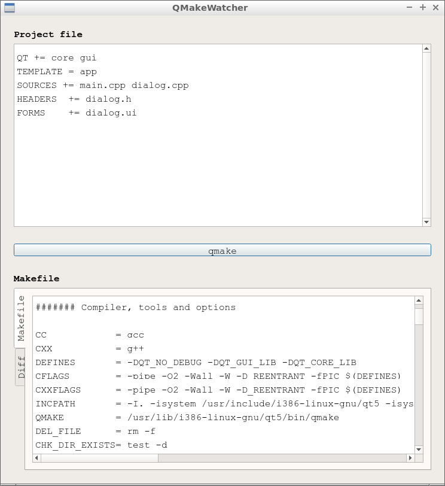

# QmakeWatcher

See what qmake does to a makefile.

QmakeWatcher is one of [Richèl Bilderbeek's tools](https://richelbilderbeek.github.io/tools/).

## Links

- [Source code](https://github.com/richelbilderbeek/QmakeWatcher)
- [Richèl Bilderbeek's tools](https://richelbilderbeek.github.io/tools/)
